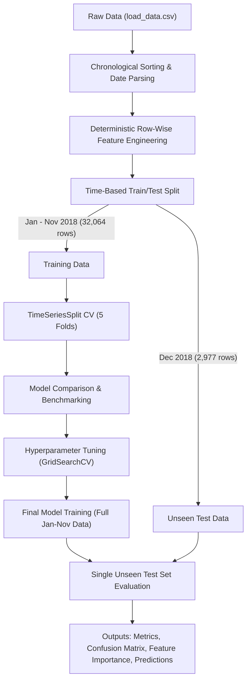

# Power System Load Type Prediction using Machine Learning

[](https://www.python.org/downloads/)
[](https://opensource.org/licenses/MIT)
[](https://github.com/psf/black)
[](https://docs.pytest.org/)

A production-grade, reproducible Machine Learning project developed for power system operational load type categorization (`Light_Load`, `Medium_Load`, `Maximum_Load`) using time-series smart meter telemetry.

---

## Table of Contents

- [Problem Statement](#problem-statement)
- [Objective](#objective)
- [Dataset](#dataset)
- [Features](#features)
- [Target Variable](#target-variable)
- [Methodology & Zero-Leakage Architecture](#methodology--zero-leakage-architecture)
- [Data Preprocessing](#data-preprocessing)
- [Exploratory Data Analysis](#exploratory-data-analysis)
- [Feature Engineering](#feature-engineering)
- [Time-Based Validation](#time-based-validation)
- [Machine Learning Models](#machine-learning-models)
- [Model Evaluation](#model-evaluation)
- [Verified Results](#results)
- [Feature Importance](#feature-importance)
- [Error Analysis](#error-analysis)
- [Project Structure](#project-structure)
- [Installation](#installation)
- [How to Run](#how-to-run)
- [Example Prediction](#example-prediction)
- [Future Improvements](#future-improvements)
- [License](#license)

---

## Problem Statement

In electrical power distribution grids and industrial facilities, electrical power demand fluctuates continuously throughout the 24-hour diurnal cycle, across business vs. weekend operating schedules, and across seasonal periods. Accurate identification and forecasting of load levels—`Light_Load`, `Medium_Load`, and `Maximum_Load`—is vital for:

1. **Grid Stability & Peak-Shaving:** Preventing transmission line congestion and transformer thermal overloading.
2. **Economic Optimization:** Avoiding expensive maximum demand penalty tariffs through automated Demand-Side Management (DSM).
3. **Operational Planning:** Scheduling reactive power compensation capacitors and optimal generator dispatch.

---

## Objective

The objective of this project is to develop, validate, and evaluate an end-to-end Machine Learning classification model that accurately predicts the **`Load_Type`** of an industrial power system based on continuous operational telemetry and engineered temporal signals.

**Key Engineering Standards:**
- Strict **time-series split**: The **entire final month (December 2018)** is reserved strictly as the unseen test set; all prior months (**January – November 2018**) form the training set.
- **Zero data leakage**: Imputation, scaling, feature engineering, cross-validation, and hyperparameter tuning are fitted exclusively on training data.
- **Time-aware cross-validation**: Evaluated across 5 sequential splits using `TimeSeriesSplit`.
- **Modular codebase**: Clean separation of concerns into `src/` modules, unit tests, reproducible training pipelines, and interactive notebooks.

---

## Dataset

The dataset (`load_data.csv`) contains continuous 15-minute operational recordings collected from an industrial smart meter over the entire 2018 calendar year.

- **Total Records:** 35,041 observations
- **Temporal Span:** January 1, 2018 00:00:00 to December 31, 2018 23:45:00
- **Sampling Frequency:** 15-minute intervals (96 intervals per day)
- **Missing Values:** Handled via median imputation fitted strictly on training observations.

---

## Features

| Feature Name | Type | Unit | Description |
| :--- | :--- | :--- | :--- |
| `Usage_kWh` | Continuous | kWh | Active power consumption recorded per 15-minute interval |
| `Lagging_Current_Reactive.Power_kVarh` | Continuous | kVarh | Inductive reactive power consumed |
| `Leading_Current_Reactive_Power_kVarh` | Continuous | kVarh | Capacitive reactive power consumed |
| `CO2(tCO2)` | Continuous | tCO₂ | Carbon dioxide emissions generated |
| `Lagging_Current_Power_Factor` | Continuous | % | Power factor during lagging current conditions |
| `Leading_Current_Power_Factor` | Continuous | % | Power factor during leading current conditions |
| `NSM` | Continuous | s | Number of Seconds from Midnight (0 to 86,400) |
| `hour`, `minute`, `day`, `month` | Discrete | Integer | Calendar date-time components |
| `day_of_week`, `day_of_year`, `is_weekend` | Discrete | Integer | Day of week (0=Mon, 6=Sun) and weekend indicator |
| `hour_sin`, `hour_cos` | Continuous | [-1, 1] | Cyclic trigonometric encoding of 24-hour cycle |
| `day_of_week_sin`, `day_of_week_cos` | Continuous | [-1, 1] | Cyclic trigonometric encoding of 7-day weekly cycle |
| `month_sin`, `month_cos` | Continuous | [-1, 1] | Cyclic trigonometric encoding of 12-month annual cycle |
| `Total_Reactive_Power_kVarh` | Continuous | kVarh | Combined reactive loading ($Q_{lag} + Q_{lead}$) |
| `Apparent_Power_Approx_kVA` | Continuous | kVA | Apparent energy loading ($\sqrt{P^2 + Q_{total}^2}$) |
| `Reactive_to_Active_Ratio` | Continuous | Ratio | Ratio of total reactive energy to active energy |

---

## Target Variable

The target variable is **`Load_Type`**, a 3-class categorical label representing the power operational state:

| Class Label | Encoded ID | Full Dataset Count | Training Count (Jan–Nov) | Test Count (Dec) |
| :--- | :---: | :---: | :---: | :---: |
| **`Light_Load`** | `0` | 18,073 (51.58%) | 16,328 (50.92%) | 1,745 (58.62%) |
| **`Medium_Load`** | `1` | 9,696 (27.67%) | 8,992 (28.04%) | 704 (23.65%) |
| **`Maximum_Load`** | `2` | 7,272 (20.75%) | 6,744 (21.03%) | 528 (17.74%) |
| **Total** | — | **35,041** | **32,064 (91.5%)** | **2,977 (8.5%)** |

---

## Methodology & Zero-Leakage Architecture



---

## Data Preprocessing

1. **Chronological Sorting:** The dataset is indexed strictly in ascending chronological order (`2018-01-01 00:00:00` to `2018-12-31 23:45:00`).
2. **Missing Value Handling:** Missing telemetry points are imputed via **median imputation** computed strictly from training fold observations.
3. **Feature Scaling:** `StandardScaler` is applied within scikit-learn `Pipeline` objects for distance-sensitive algorithms (e.g., Logistic Regression). Tree-based ensembles operate directly on unscaled features to preserve natural feature thresholds.

---

## Exploratory Data Analysis

All generated figures are stored in `outputs/figures/`:
- **`eda_target_distribution.png`**: Class balance and support across load regimes.
- **`eda_missing_values.png`**: Breakdown of missing value percentages per telemetry signal.
- **`eda_numerical_distributions.png`**: Histograms and KDE distributions of active/reactive powers and power factors.
- **`eda_correlation_heatmap.png`**: Pearson correlation matrix identifying colinearities.
- **`eda_usage_over_time.png`**: Active power consumption time-series with 7-day and 30-day rolling averages.
- **`eda_load_type_over_time.png`**: Weekly area proportions of load regimes across the entire year.
- **`eda_usage_by_load_type.png`**: Boxplots and violin distributions showing power separation across load regimes.
- **`eda_load_type_by_month.png`**: Monthly seasonal breakdown of load classes.
- **`eda_load_type_by_hour.png`**: 24-hour diurnal cycle showing peak vs. base load periods.
- **`eda_power_features_relationships.png`**: Inter-variable relationships between reactive power, power factors, CO₂, and load regimes.

---

## Time-Based Validation

Random $k$-fold cross-validation or random `train_test_split` leaks future cyclic patterns into past predictions. To simulate real-world forward deployment:
- **Test Set:** December 2018 (final calendar month; 2,977 observations).
- **Training Cross-Validation:** 5-fold `TimeSeriesSplit` on January–November 2018.

---

## Machine Learning Models

Five distinct classification algorithms were implemented and benchmarked:
1. **Logistic Regression:** Multinomial multi-class classifier with L-BFGS solver and standard feature scaling.
2. **Decision Tree Classifier:** Baseline tree-based classifier.
3. **Random Forest Classifier:** Bagged ensemble of decision trees.
4. **Gradient Boosting Classifier:** Forward stage-wise additive gradient boosted trees.
5. **XGBoost Classifier:** Extreme gradient boosted trees with histogram-based splitting.

---

## Model Evaluation

### Time-Series Cross-Validation Comparison (Training Data: Jan–Nov 2018)

| Model | Accuracy (Mean) | Accuracy (Std) | Precision (Weighted) | Recall (Weighted) | F1-Score (Weighted Mean) | F1-Score (Macro Mean) |
| :--- | :---: | :---: | :---: | :---: | :---: | :---: |
| **Random Forest** *(Top Candidate)* | **0.8622** | ±0.1126 | **0.8546** | **0.8622** | **0.8562** | **0.8336** |
| **XGBoost** | 0.8598 | ±0.1050 | 0.8546 | 0.8598 | 0.8546 | 0.8322 |
| **Gradient Boosting** | 0.8568 | ±0.1048 | 0.8511 | 0.8568 | 0.8514 | 0.8290 |
| **Decision Tree** | 0.8358 | ±0.0978 | 0.8334 | 0.8358 | 0.8317 | 0.8060 |
| **Logistic Regression** | 0.7222 | ±0.1021 | 0.7193 | 0.7222 | 0.6895 | 0.6524 |

---

## Results

### Final Model Performance on Unseen Test Set (December 2018)

The top-performing model (**Random Forest**, tuned with `n_estimators=100`, `max_depth=12`, `min_samples_split=2`, `min_samples_leaf=2`) was trained on all 32,064 records (January–November) and evaluated **once** on the unseen December test set:

| Evaluation Metric | Test Score | Percentage |
| :--- | :---: | :---: |
| **Test Accuracy** | **0.9197** | **91.97%** |
| **Weighted Precision** | **0.9256** | **92.56%** |
| **Weighted Recall** | **0.9197** | **91.97%** |
| **Weighted F1-Score** | **0.9197** | **91.97%** |
| **Macro Precision** | **0.9109** | **91.09%** |
| **Macro Recall** | **0.8940** | **89.40%** |
| **Macro F1-Score** | **0.8975** | **89.75%** |

### Per-Class Test Set Classification Report

| Class Name | Precision | Recall | F1-Score | Support (Records) |
| :--- | :---: | :---: | :---: | :---: |
| **`Light_Load`** | 0.9611 | 0.9484 | **0.9547** | 1,745 |
| **`Medium_Load`** | 0.8133 | 0.9531 | **0.8777** | 704 |
| **`Maximum_Load`** | 0.9581 | 0.7803 | **0.8601** | 528 |
| **Overall Accuracy** | — | — | **0.9197** | **2,977** |

---

## Feature Importance

Top 10 most influential features determined by Gini impurity reduction:

| Rank | Feature Name | Relative Importance Score | Domain Category |
| :---: | :--- | :---: | :--- |
| 1 | `hour` | **0.1473** | Diurnal Calendar Time |
| 2 | `NSM` (Seconds from Midnight) | **0.1388** | Exact Daily Seconds |
| 3 | `hour_sin` | **0.1266** | Cyclic Trigonometric Hour |
| 4 | `hour_cos` | **0.0884** | Cyclic Trigonometric Hour |
| 5 | `Usage_kWh` | **0.0728** | Active Power Telemetry |
| 6 | `Apparent_Power_Approx_kVA` | **0.0557** | Total Apparent Energy Loading |
| 7 | `CO2(tCO2)` | **0.0534** | Carbon Telemetry |
| 8 | `Lagging_Current_Power_Factor` | **0.0463** | Inductive Power Factor Efficiency |
| 9 | `day_of_year` | **0.0406** | Seasonal Day of Year |
| 10 | `Reactive_to_Active_Ratio` | **0.0338** | Power Factor Dynamics |

> **Note on Feature Importance vs. Causality:** Feature importances indicate statistical contribution and variance reduction across tree partitions in the ensemble; they represent predictive association rather than direct causal mechanisms.

---

## Error Analysis

- **Total Test Samples:** 2,977
- **Total Misclassifications:** 239 (Error Rate: **8.03%**)
- **Key Error Patterns:**
  - `Maximum_Load` mispredicted as `Medium_Load`: 82 cases (predominantly during ramp-down shift transitions at 17:00–18:00).
  - `Light_Load` mispredicted as `Medium_Load`: 72 cases (early morning startup periods at 06:00–07:00).
  - High confidence maintained on core operating hours; misclassifications cluster at tariff switching boundaries.

---

## Project Structure

```
power-load-type-prediction/
│
├── data/
│   ├── raw/
│   │   └── load_data.csv              # Raw time-series dataset
│   └── processed/                     # Processed splits / intermediate tables
│
├── notebooks/
│   └── Power_Load_Type_Prediction.ipynb # Fully documented Jupyter Notebook
│
├── src/
│   ├── __init__.py                    # Package initializer
│   ├── data_loader.py                 # Data ingestion, validation, chronological sort
│   ├── preprocessing.py               # Preprocessing pipelines, split logic, target encoder
│   ├── feature_engineering.py         # Cyclic, temporal, and power-domain features
│   ├── eda.py                         # Reusable publication-quality visualization functions
│   ├── models.py                      # Model catalog, TimeSeriesSplit CV, tuning
│   ├── evaluation.py                  # Test metrics, confusion matrix, error analysis
│   ├── train.py                       # End-to-end training and artifact generation script
│   └── predict.py                     # Production inference function
│
├── models/
│   ├── final_load_type_model.joblib   # Persisted tuned final pipeline
│   └── preprocessor.joblib            # Persisted preprocessor artifact
│
├── outputs/
│   ├── figures/                       # Generated EDA and evaluation plots
│   ├── metrics/                       # CSV/JSON performance tables and summaries
│   └── predictions/
│       └── test_predictions.csv       # Unseen test set predictions with error flags
│
├── tests/
│   ├── __init__.py
│   └── test_pipeline.py               # Automated pytest suite (7 unit & integration tests)
│
├── requirements.txt                   # Dependency manifest
├── README.md                          # Comprehensive technical documentation
├── .gitignore                         # Standard git ignore rules
└── LICENSE                            # MIT License
```

---

## Installation

```bash
# 1. Clone repository
git clone https://github.com/<your-username>/power-load-type-prediction.git
cd power-load-type-prediction

# 2. Create virtual environment
python -m venv venv

# 3. Activate virtual environment
# On Windows:
venv\Scripts\activate
# On Linux/macOS:
source venv/bin/activate

# 4. Install required dependencies
pip install -r requirements.txt
```

---

## How to Run

### 1. Execute End-to-End Training Pipeline
```bash
python src/train.py
```

### 2. Run Automated Pytest Suite
```bash
pytest tests/test_pipeline.py -v
```

### 3. Launch Jupyter Notebook
```bash
jupyter notebook notebooks/Power_Load_Type_Prediction.ipynb
```

---

## Example Prediction

```python
from src.predict import predict_load_type

# Single sample input (raw operational telemetry)
sample_telemetry = {
    "Date_Time": "15-12-2018 14:30",
    "Usage_kWh": 68.4,
    "Lagging_Current_Reactive.Power_kVarh": 28.5,
    "Leading_Current_Reactive_Power_kVarh": 0.0,
    "CO2(tCO2)": 0.03,
    "Lagging_Current_Power_Factor": 92.4,
    "Leading_Current_Power_Factor": 100.0,
    "NSM": 52200,
}

# Run inference
prediction, probabilities = predict_load_type(sample_telemetry, return_proba=True)

print("Predicted Load Type:", prediction[0])
# Output: 'Maximum_Load'
```

---

## Future Improvements

1. **Sequential Deep Learning:** Evaluate Temporal Convolutional Networks (TCN) or PatchTST Transformers to capture multi-scale autoregressive lag patterns.
2. **Lagged Window Features:** Add rolling active power statistics ($t-1$, $t-4$, $t-96$ for 24-hour lag) for real-time temporal momentum.
3. **Microservice Deployment:** Containerize the inference pipeline into a high-throughput REST API using FastAPI and Docker.
4. **Continuous Drift Monitoring:** Integrate Evidently AI / River for real-time concept drift monitoring and automated pipeline retraining.

---

## License

This project is licensed under the [MIT License](LICENSE).
